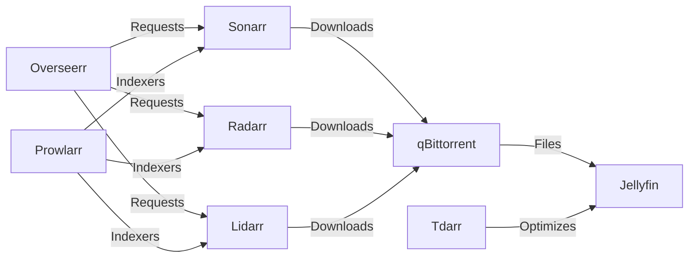

```bash
kubectl create secret generic nordvpn-credentials \
  --namespace=media-stack \
  --type=Opaque \
  --from-literal=OPENVPN_USER='x' \
  --from-literal=OPENVPN_PASSWORD='x' \
  --from-literal=WIREGUARD_PRIVATE_KEY='your_private_key_here'
```

```bash
kubectl patch secret nordvpn-credentials --namespace=media-stack \
  --type='json' -p='[{"op" : "add" , "path" : "/data/WIREGUARD_PRIVATE_KEY" , "value" : "'$(echo -n 'your_private_key_here' | base64 -w0)'" }]'
```


## How To Get Your PRIVATE_KEY for wireguard
- https://github.com/bubuntux/nordlynx?tab=readme-ov-file#how-to-get-your-private_key
```bash
docker run --rm --cap-add=NET_ADMIN -e TOKEN={{{TOKEN}}} ghcr.io/bubuntux/nordvpn:get_private_key
```


## Storage Architecture

### Overview

| Volume | Type | Access | Backend | Used by |
|--------|------|--------|---------|---------|
| `media-data` | NFS | RWX | `192.168.0.16:/mnt/pool2/jellyfin/media` | all apps (`/data`: movies, tv, downloads) |
| `media-stack-config` | NFS | RWX | `192.168.0.16:/mnt/pool2/AppData` | per-app `/config` via `subPath: <app>/config` (apps still on NFS) |
| `radarr-config` | iSCSI | RWO | `pool2/k8s/media-iscsi/pvc-<uuid>` | radarr `/config` |
| `sonarr-config` | iSCSI | RWO | `pool2/k8s/media-iscsi/pvc-<uuid>` | sonarr `/config` |
| `qbittorrent-config` | iSCSI | RWO | `pool2/k8s/media-iscsi/pvc-<uuid>` | qbittorrent `/config` |

### Why some config volumes are on iSCSI

The large media library (`media-data`) stays on NFS (RWX) — many pods read it
concurrently and it holds no databases.

App **config** is different: the *arr apps keep SQLite databases under `/config`.
SQLite on NFS suffers from lock stalls and periodic corruption (observed:
`radarr.db.pre-repair-*` backups, API hangs under I/O load). `radarr`, `sonarr`,
and `qbittorrent` were therefore moved to **dedicated TrueNAS iSCSI block
volumes** (ext4, proper POSIX locking) defined in
`base/_shared/iscsi-config-volumes.yaml` via the `truenas-iscsi-media`
StorageClass.

- iSCSI is **block storage → RWO only**, so each app gets its own PVC (fine,
  since every app already used a private `subPath` under the shared NFS volume).
- `datasetPath: k8s/media-iscsi` groups all zvols under one parent dataset on the
  NAS (consistent with the existing `pool2/k8s/nvmeof` convention), so they are
  easy to identify.
- `reclaimPolicy: Retain` keeps the zvol (and data) if a PVC is ever deleted.

Apps not yet migrated (jellyfin, prowlarr, bazarr, tdarr, seerr) still use the
shared `media-stack-config` NFS volume. They can be moved later using the same
pattern.

### Migration runbook (config NFS → iSCSI)

Done per app, with ArgoCD auto-sync **suspended** during the window:

1. Suspend ArgoCD auto-sync for the `media-stack` Application.
2. Apply `base/_shared/iscsi-config-volumes.yaml` (SC + empty RWO PVCs).
3. `kubectl scale deploy/<app> --replicas=0` (clean SQLite shutdown).
4. Run a one-shot migrator pod mounting the old NFS config (`media-stack-config`
   + `subPath: <app>/config`, read-only) and the new PVC, then
   `cp -a /old/. /new/` (preserves `1001:1001` ownership / timestamps / perms).
5. Verify DB + `config.xml` copied with correct ownership.
6. Delete migrator pods, re-enable ArgoCD auto-sync → rollout binds the new PVCs.
7. Verify each app: data intact (movie/series counts), download-client reaches
   `qbittorrent:8080`, qBittorrent security settings preserved.

The old data remains in place on NFS under `pool2/AppData/<app>/config` as a
rollback point.

### Operational notes

- **Startup probes** on radarr/sonarr were relaxed (`failureThreshold: 30`,
  `timeoutSeconds: 5`): first boot after migration runs SQLite DB migration on a
  large DB and exceeded the previous tight probe window, causing a restart loop.
- **iSCSI is RWO**: an app's pod must fully release its config volume before a
  new pod on another node can attach it. During rollouts, ensure the old
  ReplicaSet is scaled to 0 to avoid `Multi-Attach` errors.
- **NVMe-oF (`truenas-nvmeof`) requires the `nvme_tcp` kernel module** on nodes.
  After a node reboot, ensure `linux-modules-extra-$(uname -r)` is installed and
  `nvme_tcp` is loaded (`/etc/modules-load.d/nvme_tcp.conf`), or NVMe-oF-backed
  PVCs fail to mount. iSCSI (used here) does not depend on it.
